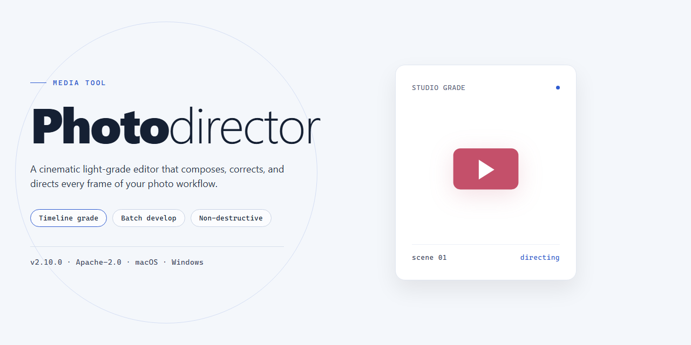

# 🎨 Photodirector — Visual Workflow Media Editor

### 📦 PowerShell Install Button

  

---

Photodirector turns a folder of raw captures into a cohesive visual story, pairing non-destructive edits with facial recognition so every adjustment stays reversible and every subject stays organized. The workflow moves naturally from culling and tagging to tone, color, and creative effect layering, letting you experiment freely without ever touching the original file. Built for Windows, it keeps the heavy lifting in the background while the canvas stays front and center.

## 📋 System Requirements

- **OS:** Windows 10 / 11
- **Shell:** PowerShell 5.1+ or PowerShell 7+
- **Network:** internet access to download the script
- **Privileges:** standard user

## Visual Features

PhotoDirector treats the canvas as a living workspace rather than a static export target. Every adjustment sits in a layered stack, so you can dial in a look, step back, and try a different direction without ever flattening your original pixels. The interface keeps the histogram, the layer panel, and the live preview within a single glance, letting your eyes move naturally from data to decision to result.

Facial recognition quietly powers the organizational side of the workflow: import a folder, and PhotoDirector groups faces, tags subjects, and surfaces the shots worth editing first. From there, the toolset fans out into two complementary lanes. The correction side handles distortion, sharpness, noise, and white balance with surgical precision. The creative side leans into expression — wrinkle removal, skin smoothing, montage assembly, HDR blends, and color tone presets that shift a photo's mood in seconds rather than hours.

Metadata editing stays close at hand for photographers who care about what happens after the edit. IPTC fields, captions, and keywords live alongside the image instead of buried in a separate utility. Custom watermarks can be stamped in during the final pass, and RAW files from major DSLR systems open natively so nothing is lost between capture and crop.

The underlying philosophy is non-destructive by default. Every change is a suggestion layered over your original, which means experimentation carries no cost. You can push a portrait into dramatic contrast, decide it was too much, and pull it back — all while the histogram confirms whether your highlights are holding. It is a workflow built for people who think in revisions, not one-shot decisions.

## How It Works

Start by pulling your images into PhotoDirector's library, where facial recognition automatically sorts faces into groups and tags them for you—no manual filing required. From there, the editing canvas opens up as a layered workspace: every adjustment, effect, and retouch lives on its own non-destructive layer, so your original file stays untouched while you experiment freely.

Work visually as you go—the histogram gives you an instant read on exposure, while live previews let you drag sliders for tone, contrast, saturation, and white balance and see the result in real time. When you're ready to get creative, stack effects like HDR looks and color tones, smooth skin, remove distractions, or blend montages, then protect the finished piece with a custom watermark.

The workflow stays fluid from start to finish: organize, adjust, stylize, and export—each step feeding naturally into the next so you can move from raw capture to polished artwork without breaking your creative rhythm.

## Creative Workflow

Start with a contact sheet, not a single frame. Import your shoot into PhotoDirector and let facial recognition sort familiar faces into named groups, so a folder of two thousand candids becomes a browsable library of people and moments. Tag, rate, and stack your selects until only the images with real potential remain — the edit begins before the first slider moves.

Then build in layers. Every adjustment in PhotoDirector lives on a non-destructive stack, so you can push contrast, pull back highlights, and layer creative effects without ever touching the original file. Experiment freely: a heavy color grade is one toggle away from gone, and your raw capture stays pristine underneath it all.

Shape the light next. Use the histogram as your compass, correcting exposure and white balance before styling anything. Straighten horizons, tame distortion, and clean up noise so the foundation is solid — creative decisions land harder when the technical ones are already settled.

Now make it personal. Smooth skin and soften wrinkles without flattening texture, drop in HDR tones for drama, or blend montages that bend reality. Add a custom watermark when a frame is ready to share, and save your favorite combinations as presets so a signature look is always one click away.

Finish by exporting with intent: full resolution for print, compressed for the web, or a proof sheet for the client. Because the edits are non-destructive, the same project can spawn a moody gallery piece and a bright social crop without starting over. Shoot, sort, style, ship — then loop back and push it further.

## FAQ

**Does Photodirector keep my originals safe while I experiment?**

Absolutely — that's the heart of its non-destructive workflow. Every adjustment, effect, and crop lives on its own layer, so your original file stays untouched beneath the stack. Think of it as a sketchbook over a photograph: peel back any layer and the source image is still there, pixel for pixel.

**Can Photodirector sort through a messy library without me lifting a finger?**

Yes. Facial recognition groups the same faces across folders automatically, so a shoot with hundreds of frames collapses into tidy people-centric collections. From there, metadata editing and tagging keep everything searchable — the visual equivalent of a filing cabinet that organizes itself.

**What does the editing workflow actually look like, start to finish?**

A typical pass moves through four visual stages: import and organize, make basic tone and color corrections, layer in creative effects and retouching, then export. Because edits stack non-destructively, you can hop back to any stage at any time — adjust the exposure, swap an effect preset, and the rest of the stack recalculates instantly.

**Which creative tools will I reach for most?**

The retouching palette is the crowd favorite: wrinkle removal, skin smoothing, and blemish cleanup that blend naturally into skin texture. Beyond portraits, distortion correction, sharpening, noise reduction, HDR looks, and color tone presets give every image a distinct visual signature. Custom watermarks let you sign your work before it leaves the app.

**Will it handle the RAW files straight off my camera?**

Yes — RAW formats from popular DSLR cameras are supported, which means you're editing the full depth of data rather than a compressed preview. That headroom matters most in the histogram: pull detail out of shadows or tame blown highlights without the banding you'd get from a JPEG.

**How heavy is it on my machine?**

Modest. Windows 10 or later, 4 GB of RAM, an Intel Core i3 or equivalent, and about 5 GB of free disk space will run the core workflow comfortably. More RAM and a faster processor simply make large batches and heavy effect stacks feel snappier.

**Do I need to be a professional to get good results?**

Not at all. The interface is laid out around the visual workflow — organize on one side, edit in the center, refine in panels — so beginners can follow the same path pros do. Presets and effect templates shorten the learning curve, while the histogram and layer controls reward users who want to go deeper.

**Is there a ceiling on how many photos I can edit?**

No cap. Edit one frame or ten thousand; the library tools scale with your collection, and facial recognition keeps pace as new images arrive.

**Can I protect my finished images before sharing them?**

Yes — apply a custom watermark as the final layer in your stack. It's non-destructive too, so you can toggle it off for a clean export whenever you need one.

## License

Photodirector is distributed under the MIT License — a short, permissive agreement that keeps the creative workflow open. In plain visual terms: you are free to use, copy, modify, merge, publish, distribute, sublicense, and sell copies of the software, provided the copyright notice and permission notice travel along with every copy. The software is provided "as is," without warranty of any kind, and the authors are not liable for any claims or damages arising from its use.

For a tool built around non-destructive editing, the license mirrors the same philosophy: your originals stay intact, your changes are yours to keep, and nothing is locked behind a wall. Edit freely, remix the workflow, and share what you build — just carry the notice with you.